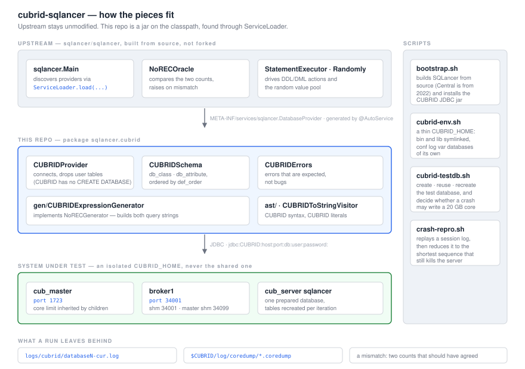

**cubrid-sqlancer** is a [SQLancer](https://github.com/sqlancer/sqlancer) provider for CUBRID.
It looks for **wrong-result bugs** — the kind where the engine returns an answer that is simply
not the right one — and it does so without needing to know the right answer in advance.

Upstream SQLancer ships providers for 23 systems. CUBRID is not one of them. This repository is that
provider, supplied as a jar on the classpath rather than as a fork.

For engine developers and QA. Part of
[CUBRID Systems Research](https://github.com/cubrid-systems).

> **Where it is:** four oracles run — NoREC plus ternary partitioning on `WHERE`, `GROUP BY` and
> `DISTINCT` — at roughly 2,000 queries/s, none with a mismatch so far. The type surface is still
> narrow; see [Status](#status).

## Prerequisites

| | Why |
|---|---|
| **JDK 11+** | SQLancer targets `--release 11`. A JRE is not enough — you need `javac` |
| **Maven 3.9+** | to build both SQLancer and this provider |
| **A CUBRID install tree** | the engine under test. Your own build (`install.out`) or an unpacked release. It is never modified — `cubrid-env.sh` symlinks `bin` and `lib` and gives the test environment its own `conf`, `log`, `var` and `databases` |
| **A SQLancer checkout** | Maven Central's `com.sqlancer:sqlancer:2.0.0` was published in January 2022 and predates `NoRECGenerator`, `NoRECOracle` and `Reproducer`. It has to be built from source |

Linux x86-64. A debug build is fine. The engine under test is whatever `$CUBRID` points at.

## Install

```bash
git clone https://github.com/cubrid-systems/cubrid-sqlancer
cd cubrid-sqlancer

git clone https://github.com/sqlancer/sqlancer.git ../sqlancer-upstream
scripts/bootstrap.sh          # builds SQLancer, installs it and the CUBRID JDBC jar into ~/.m2

mvn package                   # target/classes + target/deps
```

`scripts/bootstrap.sh` finds the JDBC driver at `$CUBRID/jdbc/cubrid_jdbc.jar`, or looks in
`~/cubrid/install.out`, `~/CUBRID` and `/opt/cubrid` if `$CUBRID` is not set.

## Getting started

Stand up an isolated engine, give it a database, and run the oracle against it.

```bash
$ eval "$(scripts/cubrid-env.sh --source ~/cubrid/install.out)"
==> creating isolated environment: .cubrid-env (source: /home/you/cubrid/install.out)
==> done. master=1723 broker=34000 shm=34000

$ scripts/cubrid-testdb.sh --reuse --port 34001
==> creating database: sqlancer (.cubrid-env/databases/sqlancer, en_US.utf8)
==> core files disabled (stack traces still land in $CUBRID/log/coredump)
==> ready
    JDBC URL: jdbc:CUBRID:localhost:34001:sqlancer:::

$ java -cp "target/classes:target/deps/*" sqlancer.Main \
    --num-threads 1 --num-tries 200 --timeout-seconds 600 \
    --host localhost --port 34001 --username dba --password "" \
    cubrid --oracle NOREC --test-database sqlancer
[18:40:31] Executed 37373 queries (543 queries/s; successful statements: 93%).
```

If `sqlancer.Main --help` lists `cubrid` among its commands, the provider was found. If it does not,
see the note about fat jars in [Architecture](#architecture).

`--num-threads` must be `1`. The provider refuses anything higher, and the reason is in
[Design decisions](#design-decisions).

## Why it exists

A wrong result is the failure mode that hides best. The engine returns rows, the driver accepts
them, and nothing reports an error — the answer is simply not the right one, and nothing in the
system is in a position to say so.

So the goal is to find those without knowing the right answer. NoREC does it by building two
queries from one predicate that must count the same rows, and letting the optimizer rewrite only
one of them:

```sql
-- optimized: the optimizer is free to rewrite the predicate
SELECT COUNT(*) FROM t WHERE <pred>;

-- reference: the predicate is pushed into the projection, where there is nothing to rewrite
SELECT SUM(norec_count) FROM (
    SELECT CASE WHEN <pred> THEN 1 ELSE 0 END AS norec_count FROM t
) AS res;
```

Two different counts mean the optimizer rewrote the predicate into something that does not mean the
same thing. That is a wrong-result bug, and the pair proves it without either query having been
told what the answer should be.

## Architecture



Upstream is built from source and left alone. `sqlancer.Main` calls
`ServiceLoader.load(DatabaseProvider.class)`, and its own Javadoc explains why that matters:

> *"To register a new provider, it is necessary to implement the DatabaseProvider interface and add
> an additional configuration file... we use an `@AutoService` annotation to create the configuration
> file automatically. **This allows SQLancer to pick up providers in other JARs on the classpath.**"*

So there is no fork to rebase and no patch to carry. Should the provider mature, the path upstream
stays open, because it follows the same package layout as the providers already there.

⚠️ **Do not build a fat jar.** Shading merges away `META-INF/services`, and SQLancer's response to
finding no providers is to quietly fall back to its built-in list
([sqlancer#799](https://github.com/sqlancer/sqlancer/issues/799)). Nothing fails; CUBRID is simply
absent. That is why `pom.xml` copies dependencies to `target/deps` instead.

## Design decisions

**It does not create a database.** CUBRID has no `CREATE DATABASE` statement — databases come from
the OS command `cubrid createdb`. So `CUBRIDProvider.createDatabase()` connects to a database that
`cubrid-testdb.sh` prepared earlier and drops the user tables and views inside it. Every thread would
be dropping the same tables, which is why `--num-threads 1` is enforced rather than suggested.

**Replay is by seed, not by log.** A session log holds only a fraction of a run — one 37,373-query
run left 319 statements in its log — so a log cannot be shrunk into a minimal reproduction. The
`-- seed value:` in the log is what matters: `crash-repro.sh --seed` makes SQLancer regenerate the
same database and query stream deterministically. Replay also defaults to JDBC, because SQLancer
reaches the server through broker and CAS while `csql` attaches to it directly, and the two paths do
not run the same code.

**BOOLEAN is not a column type.** CUBRID has no storable boolean; a predicate exists only as the
result of a comparison. `CUBRIDDataType.BOOLEAN` is therefore an expression-only pseudo-type that
`getRandomStorable()` never returns, and boolean constants are written `(1 = 1)` and `(1 = 0)`
because there is no literal to rely on.

**The reference query differs from both upstream examples.** Two details matter, and the two
providers closest to CUBRID each get one of them wrong:

- The `WHERE` clause has to be cleared. If the predicate stays in the inner query, both sides count
  the same thing and the oracle can never fire. Upstream's **DuckDB** provider does not clear it.
- The predicate has to survive into the projection. Upstream's **HSQLDB** provider replaces it with
  `COUNT(*)`, losing the predicate entirely.
- The alias must not be `count`. It is a reserved word in CUBRID, so `SUM(count)` parses as a
  function call and fails with `Syntax error: unexpected ')', expecting '('`. This one cost a full
  run: the oracle looked healthy because DDL and DML kept succeeding, while every single oracle query
  died on a syntax error and the executed-query counter sat at zero.

`CASE WHEN` rather than `CAST(pred AS INT)`, for the same reason BOOLEAN is not a column type — and
it happens to be exactly right, since `CASE WHEN` sends UNKNOWN to `ELSE`, which is the `IS TRUE`
semantics NoREC asks for.

**Schema comes from the CUBRID catalog**, not `INFORMATION_SCHEMA`:

```sql
SELECT class_name FROM db_class WHERE is_system_class = 'NO' AND class_type = 'CLASS';
SELECT attr_name, data_type, prec FROM db_attribute WHERE class_name = ? ORDER BY def_order;
```

`def_order` is not decoration — it is what makes generated `INSERT` column lists line up.

**The engine runs in its own home.** CUBRID defaults the master port (1523), the broker ports
(33000, 30000) and the shared-memory ids identically in every install tree. Put two trees on one
machine and whichever master starts first owns the port; every `cubrid` command from the other tree
then talks to *someone else's* master. `cubrid server status` shows you a stranger's databases and
your own quietly disappears. While this repository was being written, six `cub_master` processes from
six different trees were running on the development machine.

| | default |
|---|---|
| master port (`cubrid_port_id`) | 1723 |
| broker ports | query_editor 34000, **BROKER1 34001** |
| `APPL_SERVER_SHM_ID` | 34000, 34001 |
| `MASTER_SHM_ID` | 34099 — it must differ from every `APPL_SERVER_SHM_ID` |

**Core files are off by default.** A CUBRID server core is 10–20 GB because of the shared memory
segment, and a crash-inducing workload writes one every few minutes; four of them filled a 228 GB
root filesystem here. CUBRID writes a symbolised backtrace to `$CUBRID/log/coredump/*.coredump`
without the core, which is usually what you actually wanted. `--core-dump on` if you need the whole
thing.

The subtlety: `ulimit -c 0` in your shell is not enough. When the server crashes, `cub_master`
restarts it, and the new process inherits the *master's* limit. `cubrid-testdb.sh` reads
`/proc/<pid>/limits` and restarts the master under the limit when it has to.

## Status

| | |
|---|---|
| engine under test | whatever `$CUBRID` resolves to — `cubrid-env.sh` records the build in `.cubrid-env/.ready` and prints it on every run |
| provider discovery | ✅ `cubrid` appears in `sqlancer.Main --help` |
| schema, DDL, DML | ✅ `CREATE TABLE`, `INSERT`, `UPDATE`, `DELETE`, `CREATE INDEX` |
| **oracles** | `NOREC`, `WHERE`, `GROUP_BY`, `DISTINCT` — all four verified, no mismatch |
| NoREC | ✅ 534,789 queries, 91% statement success |
| TLP `WHERE` | ✅ 718,341 queries, 95% |
| TLP `GROUP_BY` | ✅ 177,277 queries, 95% |
| TLP `DISTINCT` | ✅ 174,309 queries, 96% |
| oracles not wired | `HAVING`, `AGGREGATE` — an aggregate over grouped rows is not preserved by partitioning the input the way a group key is |
| types | `INTEGER` `SMALLINT` `BIGINT` `DOUBLE` `FLOAT` `NUMERIC(p,s)` `CHAR` `VARCHAR` `DATE` `TIME` `DATETIME` |
| types not covered | `BIT` `BLOB` `CLOB` `ENUM` `JSON`, collections |
| actions not covered | `CREATE VIEW`, `ALTER TABLE` |
| concurrency | ❌ single-threaded by construction |

## Layout

```
cubrid-sqlancer/
├── pom.xml                          no shade plugin, on purpose
├── docs/assets/                     banner.svg, architecture.svg
├── scripts/
│   ├── bootstrap.sh                 build SQLancer, install it and the JDBC driver
│   ├── cubrid-env.sh                an isolated CUBRID_HOME with its own ports and shm ids
│   ├── cubrid-testdb.sh             create / reuse / recreate the test database; core-file policy
│   └── crash-repro.sh               replay a run by seed, over JDBC, to reproduce a crash
└── src/main/java/sqlancer/cubrid/
    ├── CUBRIDProvider.java          @AutoService entry point; empties the prepared database
    ├── CUBRIDOptions.java           --oracle, --test-database
    ├── CUBRIDSchema.java            catalog queries and the type model
    ├── CUBRIDErrors.java            errors that are expected rather than interesting
    ├── CUBRIDOracleFactory.java     NOREC, WHERE, GROUP_BY, DISTINCT
    ├── CUBRIDToStringVisitor.java   CUBRID syntax, including LIMIT offset, count
    ├── ast/                         9 expression node types
    ├── gen/                         table, insert, update and expression generators
    └── oracle/tlp/                  ternary partitioning: GROUP BY and DISTINCT
```

## Contributing

`main` is the only branch. Changes arrive as a branch and a pull request.

CI on every push and pull request builds SQLancer from source, builds the provider, and then asserts
the two things that fail silently rather than loudly: that `@AutoService` wrote
`META-INF/services/sqlancer.DatabaseProvider`, and that `sqlancer.Main --help` actually lists
`cubrid`. A provider that compiles but is never discovered looks exactly like a healthy run.
